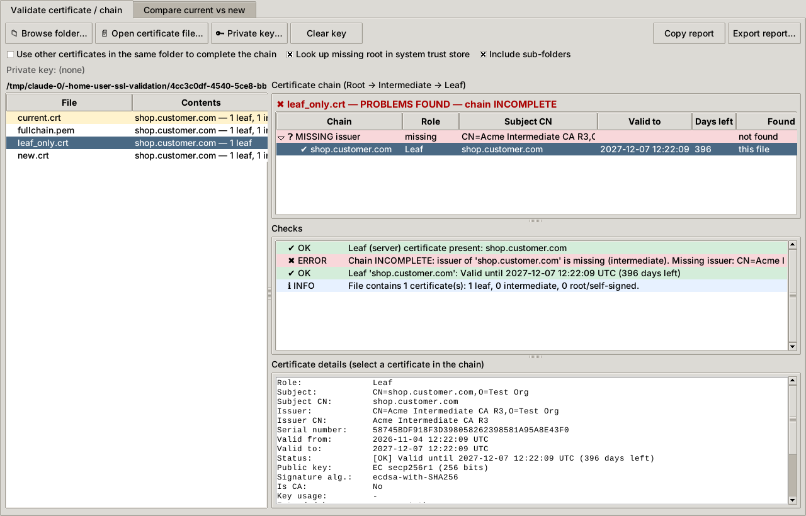
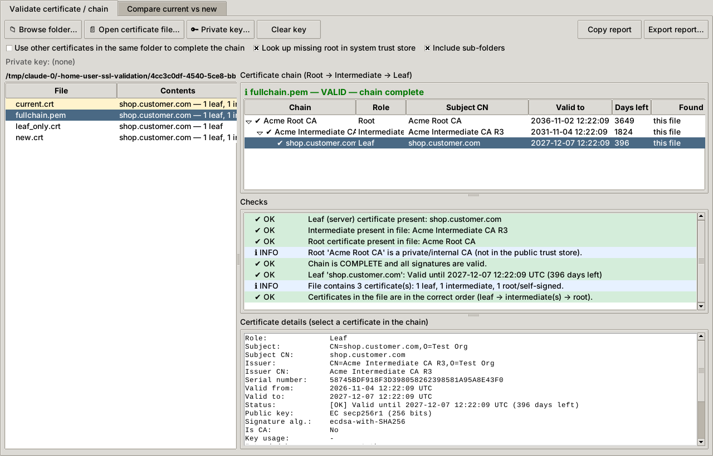
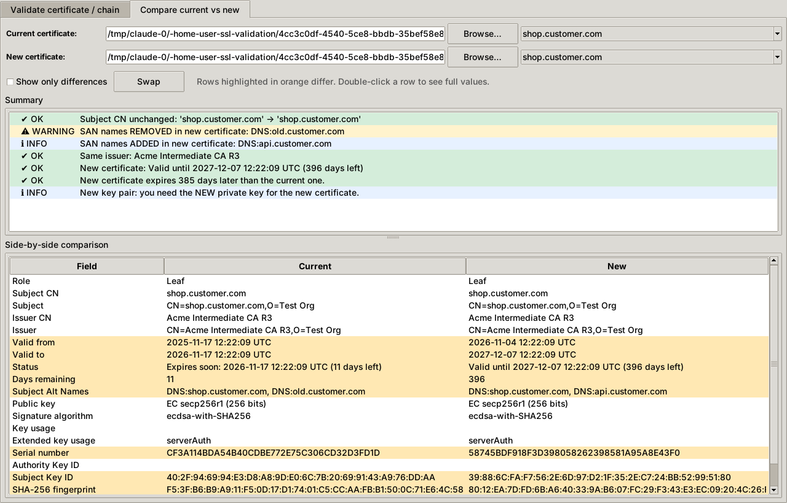

# SSL Certificate Validator

A desktop tool (Python + Tkinter) to check the SSL/TLS certificates customers send you.

## Features

**Validate certificate / chain** tab
- **Browse a folder**: every certificate file in it (and sub-folders) is listed with a quick summary
  (CN, how many leaf / intermediate / root certificates it contains). Expired or expiring files are highlighted.
- Click a file to see its **chain** (Root → Intermediate → Leaf) and a list of checks:
  - which parts are **present** and which are **missing** (leaf, intermediate(s), root), with the
    download URL of a missing issuer when the certificate gives one (AIA "CA Issuers")
  - every signature in the chain is verified
  - certificates in the file are in the right order (leaf first), no duplicates or unrelated certificates
  - validity dates (expired / not yet valid / expires within 30 days), leaf outliving its issuer
  - SAN present, serverAuth usage, weak keys (RSA < 2048) or weak hashes (SHA-1/MD5)
  - a missing root is looked up in the system / Mozilla trust store (public CA vs. private CA)
  - optional: use the **other files in the same folder** to complete the chain (for customers who send
    `server.crt`, `intermediate.crt` and `root.crt` separately)
- **Private key check**: choose a `.key` (or `.pfx`) to confirm it matches the leaf certificate.
- Full details for each certificate: Subject (CN=…), Issuer, validity, serial, SANs, key, fingerprints…
- Copy or export the report as text.

**Compare current vs new** tab
- Browse the **current** and the **new** certificate. Side-by-side table with differing rows highlighted
  (Subject CN, Subject, Issuer, validity dates, days remaining, SANs, key, signature algorithm, serial, fingerprints…).
- Summary: CN changed?, SAN names added/removed, issuer changed (new intermediate needed), new expiry vs. old,
  key reused or new private key needed.
- If a file contains several certificates, the leaf is picked automatically; use the drop-down to choose another.

Supported formats: PEM (`.pem .crt .cer .ca-bundle`, single or bundled), DER (`.der .cer`),
PKCS#7 (`.p7b .p7c`), PKCS#12 (`.pfx .p12`, password asked when needed).

## Install & run

Requires Python 3.9+ with Tkinter (included in the python.org installer for Windows/macOS;
on Debian/Ubuntu: `sudo apt install python3-tk`).

```bash
pip install -r requirements.txt
```

```bash
python -m ssl_validator
```

On Windows you can also double-click `ssl_validator.pyw`.

### Command line (optional)

```bash
python -m ssl_validator validate customer/fullchain.pem --key customer/server.key
```

```bash
python -m ssl_validator compare current/server.crt new/server.crt
```

`validate` exits with 0 = OK, 1 = warnings, 2 = errors.

### Build a standalone .exe (optional)

```bash
pip install pyinstaller
```

```bash
pyinstaller --onefile --windowed --name SSLValidator --collect-data certifi ssl_validator.pyw
```

## Tests

```bash
pip install pytest
```

```bash
python -m pytest -q
```

## Screenshots

Missing intermediate:


Full chain:


Current vs new:

